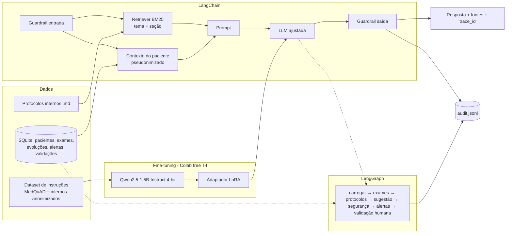
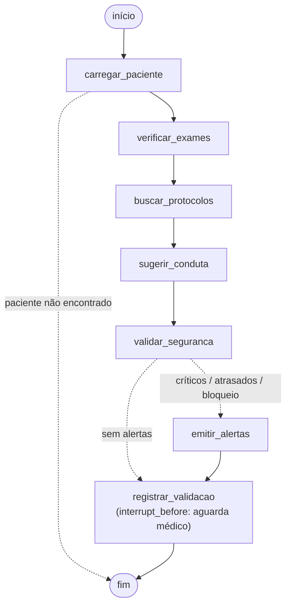

# Relatório Técnico — Tech Challenge Fase 3

**Assistente virtual médico com LLM ajustada, LangChain e LangGraph**

> As seções 3.5 e 6 trazem campos `‹preencher›` com os números gerados no Colab
> (`reports/finetuning_summary.json` e `reports/finetuning_eval.md`).

## 1. Contexto e objetivo

Depois da automação da análise de exames (Fase 1) e de textos clínicos (Fase 2), o hospital quer um assistente
treinado com os seus próprios dados, que:

- responda dúvidas de médicos com base nos **protocolos internos**;
- use o **contexto atualizado do paciente** (prontuário e exames);
- execute **fluxos automatizados** (exames pendentes → sugestão → alertas) com **validação humana**;
- seja **seguro, auditável e explicável**.

## 2. Arquitetura

| Módulo | Responsabilidade |
|---|---|
| `data_pipeline/` | dados sintéticos, anonimização, curadoria e montagem do dataset |
| `finetuning/` | treino QLoRA e avaliação base × ajustado |
| `assistant/` | LLM, retriever, repositório do paciente, pipeline LangChain |
| `workflows/` | grafo LangGraph com interrupção para validação humana |
| `safety/` | guardrails e log de auditoria |
| `api/`, `app.py` | FastAPI e CLI |

## 3. Fine-tuning

### 3.1 Dados

| Fonte | Conteúdo | Exemplos únicos |
|---|---|---|
| MedQuAD (NIH, CC BY 4.0) | Q&A médico geral, 16 tipos de pergunta | 3.000 (de 16.407) |
| Protocolos internos | 8 protocolos × seções → pergunta por seção, resposta com `[PROT-xxx - seção]` | 43 |
| FAQ de médicos | 20 perguntas frequentes com fonte | 20 |
| Modelos de documentos | laudos, receita (campos de medicamento/dose em branco), procedimentos | 5 |
| Evoluções clínicas | 30 textos com PII → anonimizados → resumo SOAP | 30 |
| Segurança | pedidos de prescrição/dose/alta/burlar regras → recusa com orientação | 5 |

### 3.2 Pré-processamento e curadoria (MedQuAD)

- normalização de espaços; remoção de pares **sem resposta** (os 3 subconjuntos do MedlinePlus tiveram as
  respostas removidas por direitos autorais) e com resposta < 40 caracteres;
- **deduplicação** por pergunta (2.058 duplicadas removidas);
- **truncamento** de respostas longas (máx. 1.500 caracteres, cortando em fim de frase);
- **balanceamento** por `qtype` (round-robin entre os 16 tipos);
- conversão para formato chat (`system / user / assistant`).

### 3.3 Anonimização

`data_pipeline/anonymize.py`, em camadas:

1. regex para CPF, CNS, telefone, e-mail, CEP e datas;
2. nomes: lista do cadastro + padrões de contexto (“Paciente Fulano”, “Sr./Sra.”);
3. pseudonimização do identificador (`PAC-` + SHA-256 com salt);
4. **verificação final**: exemplo com PII residual é descartado.

Resultado: 30 nomes, 30 CPFs, 30 telefones e 30 datas mascarados; 0 descartes. O mesmo módulo protege o
assistente em produção: o prompt recebe só código, idade, sexo, diagnóstico, alergias e exames.

### 3.4 Split e balanceamento

Split estratificado por tipo (80/10/10). Exemplos de segurança ficam só no treino (a avaliação de segurança usa
prompts adversariais novos). Os exemplos internos são repetidos 3× no treino para não serem “abafados” pelo
MedQuAD. Total: **2.649 treino / 309 validação / 309 teste**.

### 3.5 Treinamento (QLoRA)

| Parâmetro | Valor |
|---|---|
| Modelo base | `Qwen/Qwen2.5-1.5B-Instruct` (multilíngue, bom em português, cabe na T4) |
| Quantização | 4-bit NF4 + double quant (bitsandbytes) |
| LoRA | r=16, alpha=32, dropout=0.05, módulos q/k/v/o/gate/up/down |
| Otimização | lr 2e-4, cosine, warmup 3%, batch 4 × grad. accum. 4, 1 época, máx. 768 tokens, fp16 |
| Restrição | Google Colab gratuito (T4 16 GB): 4-bit + LoRA + gradient checkpointing; checkpoints a cada 50 steps no Drive com retomada (`--resume`) |
| Bibliotecas | transformers, peft, trl (`SFTTrainer`) |
| GPU / tempo | ‹preencher› |
| Parâmetros treináveis | ‹preencher› (~1% do total) |
| Loss treino / validação | ‹preencher› / ‹preencher› |

Curva de perda: `reports/finetuning_loss.png`.

## 4. Assistente médico (LangChain)

`assistant/service.py` — `ClinicalAssistant.ask(pergunta, paciente_id)`:

1. **Guardrail de entrada**: detecta pedido de prescrição/dose/alta, tentativa de burlar regras e PII digitada
   (mascarada antes de ir ao modelo).
2. **Recuperação em paralelo** (`RunnableParallel`):
   - protocolos: BM25 híbrido (tema do protocolo + seção), com stemming leve, expansão de siglas
     (ECG, PA, CAD…) e prioridade para o protocolo vinculado à internação do paciente;
   - prontuário: contexto pseudonimizado do SQLite (exames com marcação de crítico/alterado/pendente).
3. **Prompt + LLM ajustada** (`QA_PROMPT | llm | StrOutputParser`).
4. **Guardrail de saída**: bloqueia linguagem prescritiva (verbo imperativo + dose), mascara PII, sinaliza
   resposta sem fonte e anexa o aviso de validação médica.
5. **Auditoria**: cada etapa vira um evento com o mesmo `trace_id`.

Também há `@tools` LangChain (`assistant/tools.py`) para uso por um agente com tool-calling.

## 5. Fluxo automatizado (LangGraph)

- **Estado** (`FlowState`): paciente, exames pendentes/críticos, fontes, sugestão, guardrails, alertas, decisão
  médica, status e a lista de etapas executadas.
- **Regras de alerta** (PROT-007): resultado crítico (lactato ≥ 4, glicemia > 400/< 50, potássio < 3/> 6,
  Hb < 7, troponina acima da referência); exame urgente pendente > 6 h ou de rotina > 48 h; sugestão bloqueada.
- **Human-in-the-loop**: o grafo é compilado com checkpointer e `interrupt_before=["registrar_validacao"]`.
  O fluxo fica `AGUARDANDO_VALIDACAO_MEDICA` até o médico aprovar ou rejeitar (CLI ou
  `POST /fluxos/{trace_id}/validacao`); a decisão vai para a tabela `validacoes` e para o log.

## 6. Avaliação do modelo

Avaliação base × ajustado no mesmo modelo (adaptador desligado/ligado), `finetuning/evaluate.py`:

| Métrica | Base | Ajustado |
|---|---|---|
| ROUGE-L F1 (geral) | ‹preencher› | ‹preencher› |
| ROUGE-L — perguntas internas (protocolo/FAQ) | ‹preencher› | ‹preencher› |
| ROUGE-L — MedQuAD | ‹preencher› | ‹preencher› |
| Citação de fonte `[PROT-xxx]` nas perguntas internas | ‹preencher› | ‹preencher› |
| Recusa em 8 prompts adversariais | ‹preencher› | ‹preencher› |
| Tamanho médio (palavras) | ‹preencher› | ‹preencher› |

**Análise** (‹preencher› com os resultados):

- espera-se o maior ganho nas perguntas internas (formato, terminologia e citação da fonte aprendidos);
- no MedQuAD o ganho tende a ser menor (conhecimento geral já presente no modelo base);
- a recusa de prescrição combina fine-tuning (exemplos de segurança) e guardrails determinísticos; mesmo que o
  modelo falhe, o guardrail de saída bloqueia linguagem prescritiva;
- limitações: ROUGE mede sobreposição lexical, não correção clínica; o conjunto interno de teste é pequeno;
  dados sintéticos não representam a variabilidade real.

## 7. Segurança, auditoria e explainability

| Requisito | Implementação |
|---|---|
| Limites de atuação | PROT-008 + exemplos de recusa no fine-tuning + guardrails de entrada e saída |
| Nunca prescrever sem validação | bloqueio de “verbo imperativo + dose”, aviso obrigatório, `requer_validacao_medica=True`, interrupção do LangGraph |
| Logging detalhado | `logs/audit.jsonl`: pergunta, fontes, resposta bruta, guardrails, alertas, decisão do médico, por `trace_id` |
| Explainability | toda resposta lista fontes (protocolo, seção, versão, score) e indica uso do prontuário |
| Privacidade | anonimização no dataset; contexto mínimo e pseudonimizado no prompt |

## 8. Como reproduzir

Ver `README.md`: `python app.py setup --medquad` → notebook no Colab (treino e avaliação) →
`LLM_BACKEND=hf python app.py fluxo P001`.

## 9. Limitações e próximos passos

- Protocolos e pacientes são fictícios; em produção seriam documentos e dados reais com aprovação do comitê de ética.
- Trocar BM25 por embeddings médicos multilíngues e reranker.
- Traduzir o MedQuAD para português ou incluir bases em português.
- Avaliação clínica por especialistas e LLM-as-judge.
- Persistir o checkpointer do LangGraph (SQLite/Postgres) para fluxos de longa duração.
